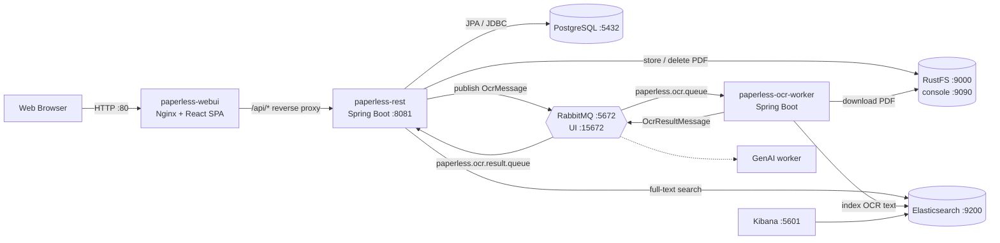
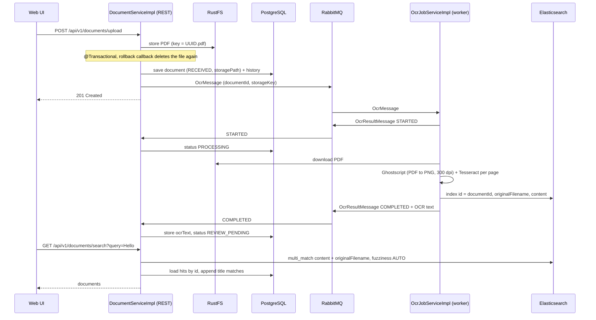

# Architecture & Design Decisions

State: Sprint 4 (version 0.4.0). Planned components of later sprints are shown dashed.

## 1. Components

All services run with `docker compose up`. The REST server waits for healthy PostgreSQL, RabbitMQ, RustFS and Elasticsearch containers, the worker for RabbitMQ, RustFS and Elasticsearch (`depends_on` + `healthcheck`). Kibana is only used to look at the document index, no application depends on it.

PostgreSQL belongs to the REST server alone. The worker has no database access, it only reads the PDF from RustFS, writes to Elasticsearch and sends its result back as a message.

## 2. Document Pipeline

The web UI reloads the list every 5 seconds while a listed document is `RECEIVED` or `PROCESSING`, so the status changes appear without a page reload. While a dialog is open the list pauses, and an open details dialog refreshes its own document and history every 5 seconds instead.

## 3. Layers in paperless-rest

| Layer | Package | Content |
| :--- | :--- | :--- |
| Presentation | `controller`, `dto`, `mapper` | REST endpoints, CRUD specific DTOs, MapStruct DTO <-> model mappers |
| Business | `service`, `service.impl`, `service.model`, `service.validation` | Service interfaces + implementations, domain models, validators, interfaces for every integration (`DocumentStorage`, `DocumentSearchIndex`, `OcrJobPublisher`) |
| Integration | `storage`, `search`, `messaging` | `RustFsDocumentStorage` (AWS SDK), `ElasticsearchDocumentSearchIndex`, `OcrMessageProducer` and `OcrResultListener` |
| Data access | `dal.persistence`, `dal.entity`, `dal.repository`, `dal.mapper` | Persistence services (only place with entities), JPA entities, Spring Data repositories |
| Cross-cutting | `exception`, `config` | Layer specific exceptions, `GlobalExceptionHandler`, validated properties per area (`RabbitMqProperties`, `RustFsProperties`) |

The business layer never sees JPA entities or SDK classes. Controllers only see DTOs and domain models. The worker uses the same split: `service` holds the interfaces (`DocumentStorage`, `OcrEngine`, `DocumentIndexer`, `OcrResultPublisher`), the technical packages (`storage`, `ocr`, `search`, `messaging`) hold the implementations.

## 4. Design Decisions

| Decision | Why |
| :--- | :--- |
| `OcrMessage` carries only a reference (document id, storage key, filename, content type, upload time) | Queue messages stay small. The worker loads the PDF from RustFS by its key instead of receiving the bytes through the broker. |
| RustFS through the AWS SDK for Java v2 | RustFS is S3 compatible and its Java guide uses the AWS SDK. One bucket `paperless-documents`, created at startup if missing, unique object keys (`UUID.pdf`). |
| Tess4J for OCR, Ghostscript as a separate process | Tesseract reads images, not PDFs. Ghostscript renders every page to PNG first. Tess4J has no Ghostscript binding, so `gs` runs through `ProcessBuilder` with a timeout. |
| Indexing inside the OCR worker (`ElasticsearchDocumentIndexer`) | The worker already has the text. A third application would only forward it. |
| Result back as an event (`OcrResultMessage` with `STARTED` and `COMPLETED`) | The database stays owned by the REST server. A later GenAI worker can bind its own queue to the same routing key and get a copy. |
| OCR text inside the `COMPLETED` message | The worker has no database access and the text is small compared to the PDF. |
| Index holds only id, filename and content, not the title | The title can change in PostgreSQL at any time. The search adds the SQL title matches, so a document is findable by title right after the upload. |
| Search results are always loaded from PostgreSQL | Elasticsearch is not the source of truth. Deleted documents never show up, the status is always current. |
| No own index mapping | Elasticsearch derives `text` fields (analyzed, fuzzy possible) with a `.keyword` sub-field on the first save. |
| Direct exchange `paperless.document.exchange` | Producer does not need to know the queue. Routing keys `document.ocr` and `document.ocr.result`. |
| `@Transactional` upload + transacted RabbitMQ channel | Metadata, history and message belong together. The message is only delivered after the database commit, so the worker never gets an id that is not in the database yet. |
| Both listeners: 3 retries with backoff, then dead-letter queue | Short failures get a second chance. After that a job lands in `paperless.ocr.dlq` and a result in `paperless.ocr.result.dlq` (both through the exchange `paperless.dlx`) instead of being redelivered endlessly or lost, and stays visible for manual replay. |
| Document list sorted by upload time, newest first | A fixed order: without it the database returns rows in storage order and an edited document would jump to another position. |
| Durable queues declared by both apps with identical arguments | Declaration is idempotent, so the start order of the containers does not matter. |
| Status checked before every automatic change | A repeated `STARTED` or `COMPLETED` (redelivery) is ignored, a document the user already rejected keeps its status. |
| Optimistic locking (`@Version`) | Concurrent updates return `409 Conflict` instead of silently overwriting data. |
| No Flyway yet, schema from `ddl-auto: update`, no foreign key on the history table | Two tables that changed often during the sprints. The service deletes history and document in one transaction, an index on `document_id` keeps the history lookup fast. Migrations can be added once the schema is stable. |

## 5. Failure Cases & Stability Patterns

| Situation | Pattern | Result |
| :--- | :--- | :--- |
| RustFS down on upload or delete | timeout (`api-call-timeout` 120 s, `api-call-attempt-timeout` 30 s) + built-in SDK retry (3 attempts) | `StorageException`, `503`, nothing saved |
| Upload transaction rolls back after the file was stored (database or broker fails) | compensation: rollback callback (`TransactionSynchronization.afterCompletion`) deletes the file when Spring reports a rollback | `503`, no row, no file. With an unknown commit outcome the file is kept, because the row may exist |
| RabbitMQ down on upload | connect timeout 5 s | `MessageQueueException`, `503`, nothing saved |
| Elasticsearch down on search | connection timeout 2 s, socket timeout 5 s + Resilience4j circuit breaker `search` with fallback | `200` with the SQL title matches, after 5 failures the breaker opens for 10 s and skips Elasticsearch |
| Elasticsearch, RustFS or OCR fails in the worker | AMQP listener retry 3x (1 s, 2 s, 4 s), then dead-letter queue | job in `paperless.ocr.dlq`, document stays `PROCESSING`, user can reject it |
| Invalid OCR message or file already deleted | reject without requeue (no retry, it can never succeed) | message in the dead-letter queue at once, logged as `ERROR` (invalid) or `WARN` (missing file) |
| REST server cannot store an OCR result (database down) | AMQP listener retry 3x (1 s, 2 s, 4 s), then dead-letter queue | event in `paperless.ocr.result.dlq`, nothing is lost, it can be published again once the database is back |
| Ghostscript hangs | process timeout 120 s, the process is killed | `OcrException`, retried like other worker failures |
| Elasticsearch down on delete | best effort | document deleted, `WARN`, the leftover index entry never shows up |

## 6. Error Handling & Logging

| Layer | Exceptions | HTTP result |
| :--- | :--- | :--- |
| Presentation | `MethodArgumentNotValidException`, `BindException` (Jakarta Validation) | 400 with `invalidParams` |
| Business | `BusinessLayerException`, `DocumentNotFoundException`, `InvalidStatusTransitionException` | 400 / 404 / 422 |
| Upload | `InvalidDocumentException`, `InvalidFileTypeException`, `MaxUploadSizeExceededException` | 400 / 415 / 413 |
| Spring MVC | malformed JSON, wrong path type, unknown URL, wrong method (`ResponseEntityExceptionHandler`) | 400 / 404 / 405 |
| Data access | `ObjectOptimisticLockingFailureException` | 409 |
| Storage | `StorageException` (wraps SDK exceptions) | 503 |
| Messaging | `MessageQueueException` (wraps `AmqpException`) | 503 |
| Search | `SearchException` | none, handled by the circuit breaker fallback |
| Anything else | `Exception` fallback | 500 with generic message |

The worker has its own exceptions (`StorageException`, `DocumentNotFoundInStorageException`, `OcrException`, `IndexingException`). They decide between retry and reject.

Logging uses SLF4J (`@Slf4j`) in the format `event text key=value`: `INFO` for events (upload, OCR started, indexed, result stored), `WARN` for rejected or ignored input, `ERROR` with the exception as last argument. File content, OCR text and credentials are never logged, only their length. A document can be followed through both apps by its `documentId` and `storageKey`.

## 7. Testing Strategy

- Unit tests with JUnit 5 + Mockito for services, validators, mappers, producers, listeners and every integration class (`S3Client`, `ElasticsearchOperations` and `RabbitTemplate` are mocked).
- Controller slice tests with `@WebMvcTest` + `MockMvc` check status codes, JSON and ProblemDetail responses.
- Persistence tests with `@DataJpaTest` on an in-memory H2 database (PostgreSQL mode), so no container is needed.
- Context tests (`@SpringBootTest`) start each application with mocked infrastructure. A small Spring context test checks the circuit breaker and its fallback.
- `TesseractOcrEngineTest` runs a real OCR on `HelloWorld.pdf`. It is skipped without `gs` and Tesseract (Windows) and runs in CI.
- Coverage with JaCoCo in both Gradle projects: `./gradlew check` fails below 70% line coverage.
- Manual end-to-end checks: `tests/sprint3-queue-check.ps1` (upload reaches the worker), `tests/sprint4-search-check.ps1` (upload, OCR, status, search), and the browser flow at `http://localhost/` (upload, live status, search, details with OCR text, title edit, status change, delete). Failure cases were checked by stopping single containers.
- GitHub Actions (`.github/workflows/ci.yml`) runs all tests, the web UI build and `docker compose build` on every push to `main` and the sprint branches and on every pull request to `main`.

## 8. Lessons Learned

- Splitting one big DTO into create / update / response DTOs makes validation per use case much clearer.
- Keeping entities inside a persistence layer made the business layer easier to test, because only models need to be mocked.
- A message broker introduces a second resource next to the database. We had to think about what happens when one of them fails (transaction + transacted channel).
- Health checks in Docker Compose are needed, otherwise the REST server starts before PostgreSQL or RabbitMQ is ready.
- Object storage has no transactions. A file that was already stored has to be removed again by a compensation when the database transaction rolls back.
- Native tools in a container (Tesseract, Ghostscript) need the right base image. The library version on the CI runner can differ from the container, so the real OCR test runs in CI too.
- An interface per integration made the failure cases easy to test: a mock can throw exactly the exception we want.
- Elasticsearch is only a search index. Loading the hits from PostgreSQL avoids stale or deleted documents in the result.
- A durable queue cannot be redeclared with new arguments, an existing broker has to drop the old queue once.

## 9. Tracked Work & References

- Repository: <https://github.com/David-Velichka/paperless-dms>
- Kanban board: GitHub Project "Paperless DMS - Scrum Kanban Board" (issues per sprint, labels `user-story` / `technical-task`)
- Changes per version: [`CHANGELOG.md`](../CHANGELOG.md)
- REST API: [`openapi.yaml`](openapi.yaml)
- Custom use case: [`custom-usecase-concept.md`](custom-usecase-concept.md)
