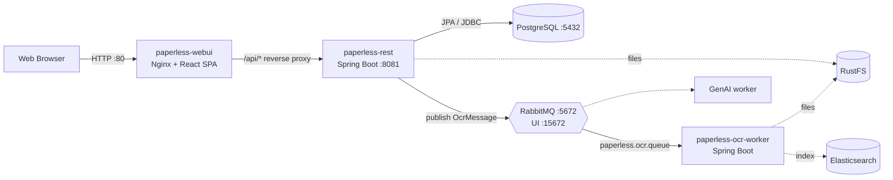
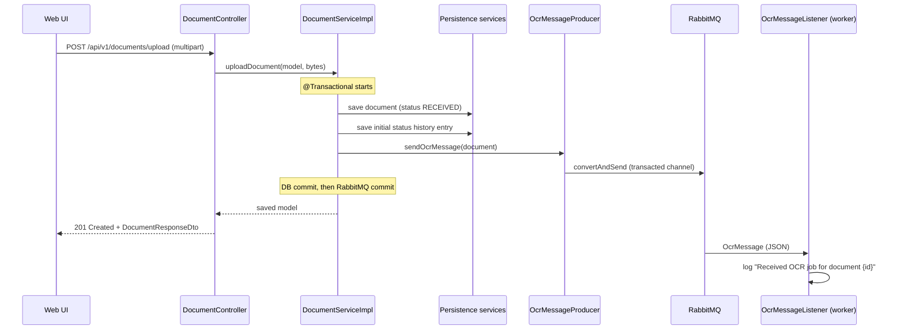

# Architecture & Design Decisions

State: Sprint 3 (version 0.3.0). Planned components of later sprints are shown dashed.

## 1. Components

All services run with `docker compose up`. The REST server and the worker wait for healthy PostgreSQL and RabbitMQ containers (`depends_on` + `healthcheck`).

## 2. Document Upload Flow

If RabbitMQ is not reachable, the producer throws `MessageQueueException`, the transaction rolls back (no document row, no history row) and the client gets `503 Service Unavailable`.

## 3. Layers in paperless-rest

| Layer | Package | Content |
| :--- | :--- | :--- |
| Presentation | `controller`, `dto`, `mapper` | REST endpoints, CRUD specific DTOs, MapStruct DTO <-> model mappers |
| Business | `service`, `service.impl`, `service.model`, `service.validation` | Service interfaces + implementations, domain models, validators |
| Messaging | `messaging` | `OcrMessageProducer` (service agent for RabbitMQ), `OcrMessage` |
| Data access | `dal.persistence`, `dal.entity`, `dal.repository`, `dal.mapper` | Persistence services (only place with entities), JPA entities, Spring Data repositories |
| Cross-cutting | `exception`, `config` | Layer specific exceptions, `GlobalExceptionHandler`, RabbitMQ and security config |

The business layer never sees JPA entities. Controllers only see DTOs and domain models.

## 4. Design Decisions

| Decision | Why |
| :--- | :--- |
| Message contains only document id, filename, content type, upload time | Queue messages should be small. The worker will load the file from RustFS by reference (Sprint 4) instead of receiving the PDF bytes through the broker. |
| Direct exchange `paperless.document.exchange` + routing key `document.ocr` | Producer does not need to know the queue. Later workers (GenAI) can get their own queue and routing key. |
| `@Transactional` on `uploadDocument` + transacted RabbitMQ channel | Metadata, history and message belong together. The message is only delivered after the DB commit, so the worker never gets an id that is not in the database yet. If the broker is down, nothing is saved. |
| Worker rejects invalid messages without requeue | A message without document id can never succeed. Requeueing it would create an endless redelivery loop. |
| Separate worker application | Heavy OCR work must not block HTTP threads and can be scaled independently. |
| Durable queue declared by both REST and worker | Declaration is idempotent, so the start order of the containers does not matter. |
| RFC 7807 `ProblemDetail` for all errors | Standard error format, no stack traces or internal messages for the client. |
| Optimistic locking (`@Version`) | Concurrent updates return `409 Conflict` instead of silently overwriting data. |

## 5. Error Handling & Logging

| Layer | Exceptions | HTTP result |
| :--- | :--- | :--- |
| Presentation | `MethodArgumentNotValidException`, `BindException` (Jakarta Validation) | 400 with `invalidParams` |
| Business | `BusinessLayerException`, `DocumentNotFoundException`, `InvalidStatusTransitionException` | 400 / 404 / 422 |
| Data access | `ObjectOptimisticLockingFailureException` | 409 |
| Messaging | `MessageQueueException` (wraps `AmqpException`) | 503 |
| Anything else | `Exception` fallback | 500 with generic message |

Logging uses SLF4J (`@Slf4j`): `info` for requests and important state changes (upload, message sent, message received), `warn` for rejected input, `error` for infrastructure failures (broker down, invalid message in the worker).

## 6. Testing Strategy

- Unit tests with JUnit 5 + Mockito for services, validators, the message producer and the worker listener. Dependencies (persistence, `RabbitTemplate`) are mocked.
- Controller slice tests with `@WebMvcTest` + `MockMvc` check status codes, JSON and ProblemDetail responses.
- Persistence tests with `@DataJpaTest` on an in-memory H2 database (PostgreSQL mode), so no container is needed.
- Coverage with JaCoCo: `./gradlew check` fails below 70% line coverage. Report: `paperless-rest/build/reports/jacoco/test/html/index.html`.
- Manual end-to-end check of the queue: `tests/sprint3-queue-check.ps1` (or `.sh`).
- GitHub Actions (`.github/workflows/ci.yml`) runs all tests, the web UI build and `docker compose build` on every push and pull request.

## 7. Lessons Learned

- Splitting one big DTO into create / update / response DTOs makes validation per use case much clearer.
- Keeping entities inside a persistence layer made the business layer easier to test, because only models need to be mocked.
- A message broker introduces a second resource next to the database. We had to think about what happens when one of them fails (transaction + transacted channel).
- Health checks in Docker Compose are needed, otherwise the REST server starts before PostgreSQL or RabbitMQ is ready.

## 8. Tracked Work & References

- Repository: <https://github.com/David-Velichka/paperless-dms>
- Kanban board: GitHub Project "Paperless DMS - Scrum Kanban Board" (issues per sprint, labels `user-story` / `technical-task`)
- Changes per version: [`CHANGELOG.md`](../CHANGELOG.md)
- REST API: [`openapi.yaml`](openapi.yaml)
- Custom use case: [`custom-usecase-concept.md`](custom-usecase-concept.md)
