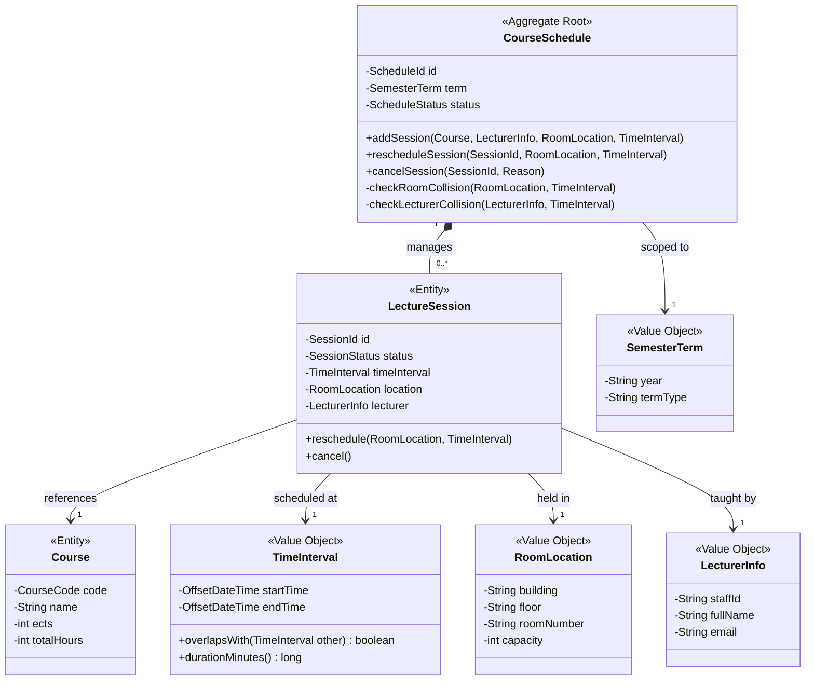
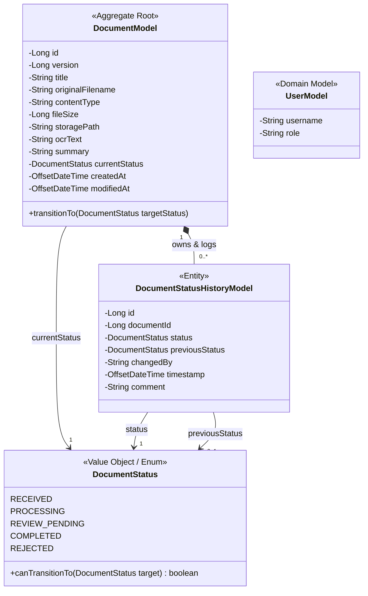

# Domain-Driven Design (DDD) & Distributed Transactions

This document records the Domain-Driven Design (DDD) models, bounded contexts, aggregate root structures, and distributed transaction strategies implemented for the Paperless Document Management System (Paperless DMS), fulfilling the requirements of Class 8 and Sprint 2.

---

## 1. Class 8 Exercise: CIS Course Schedule (LV-Plan) Domain Model

### 1.1 Context & Objective
Design a pure domain model for the creation and display of a university course schedule (Lehrveranstaltungsplan / LV-Plan) on the campus information system (CIS), identifying Entities, Value Objects, Aggregates, and the Aggregate Root, and verifying business invariants.

### 1.2 Domain Model Elements

| DDD Concept | Element Name | Type | Characteristics & Role |
| :--- | :--- | :--- | :--- |
| **Aggregate Root** | `CourseSchedule` | Aggregate Root | Main domain object; enforces consistency boundaries, schedules sessions, and checks collision invariants. |
| **Entity** | `LectureSession` | Internal Entity | Represents an individual scheduled session with a unique session ID and lifecycle (`PLANNED`, `CONFIRMED`, `CANCELLED`). |
| **Entity** | `Course` | Entity / Catalog | Represents a module or course offering with unique course code, title, and ECTS credits. |
| **Value Object** | `TimeInterval` | Value Object | Immutable time range (`startTime`, `endTime`); self-validates that `startTime < endTime`. |
| **Value Object** | `RoomLocation` | Value Object | Immutable location identifier (`building`, `floor`, `roomNumber`). |
| **Value Object** | `LecturerInfo` | Value Object | Immutable lecturer details (`staffId`, `fullName`, `academicTitle`). |
| **Value Object** | `SemesterTerm` | Value Object | Academic term representation (e.g., `WS2026`). |

### 1.3 Invariants & Business Rules
1. **Collision Invariant (Room)**: No two lecture sessions within the schedule may share the same `RoomLocation` during overlapping `TimeInterval` ranges.
2. **Collision Invariant (Lecturer)**: No lecturer may be scheduled for more than one session simultaneously.
3. **Capacity Invariant**: The enrolled student count must not exceed the specified room capacity.
4. **Credit Allocation**: Total scheduled teaching hours across all sessions in a course must match the course's accredited ECTS hours.

### 1.4 Domain Model Diagram (Mermaid)

### 1.5 Lessons Learned
- **Encapsulation over Anemia**: The Aggregate Root (`CourseSchedule`) actively guards invariants rather than relying on external procedural service scripts.
- **Value Object Immutability**: Modeling time slots and room locations as immutable Value Objects eliminates unintended side-effects and guarantees structural integrity.
- **Consistency Boundary**: Modifications to individual lecture sessions must pass through the `CourseSchedule` Aggregate Root to guarantee cross-session collision checks.

---

## 2. Paperless DMS Domain Model

### 2.1 Bounded Context & Ubiquitous Language
The Paperless Document Management System operates within the **Document Management & Archival** bounded context:
- **Document**: The core digital asset representing an ingested business file, its metadata, and its processing state.
- **DocumentStatus**: The explicit, validated lifecycle state of a document (`RECEIVED`, `PROCESSING`, `REVIEW_PENDING`, `COMPLETED`, `REJECTED`).
- **DocumentStatusHistory**: An immutable, append-only record capturing who transitioned the document, when, and with what comment.
- **StorageKey**: The unique, content-derived object storage URI pointing to the binary in RustFS.

### 2.2 Paperless Aggregate Root: `DocumentModel`
The `DocumentModel` functions as the Aggregate Root for documents in the business layer:
- **Identity**: Unique numerical identifier (`id`).
- **Internal Entity**: Encapsulates child entity `DocumentStatusHistoryModel` (1:n relation).
- **Self-Managing State Machine**: The method `DocumentModel.transitionTo(targetStatus)` checks valid state transitions before updating state. If an invalid jump is requested, it throws a `BusinessLayerException`.
- **Concurrency Guard**: Incorporates a numerical `version` field for Optimistic Concurrency Control (OCC).

### 2.3 Paperless DMS Domain Model Diagram (Mermaid)

### 2.4 Architectural Layer Decoupling

```mermaid
flowchart TD
    subgraph PresentationTier ["Presentation Tier (REST & WebUI)"]
        DocumentController["DocumentController"]
        HistoryController["DocumentStatusHistoryController"]
        DocumentDto["DocumentDto / Request DTOs"]
    end

    subgraph BusinessLayer ["Business Layer (Domain Model & Services)"]
        DocumentService["DocumentService (Interface)"]
        HistoryService["DocumentStatusHistoryService (Interface)"]
        DocumentServiceImpl["DocumentServiceImpl"]
        HistoryServiceImpl["DocumentStatusHistoryServiceImpl"]
        DocumentModel["DocumentModel (Aggregate Root)"]
        HistoryModel["DocumentStatusHistoryModel"]
        ModelValidator["DocumentModelValidator"]
    end

    subgraph MappingLayer ["Mapping Tier (MapStruct)"]
        DocumentMapper["DocumentMapper"]
        HistoryMapper["DocumentStatusHistoryMapper"]
    end

    subgraph DataAccessLayer ["Data Access Layer (PostgreSQL)"]
        DocumentRepository["DocumentRepository (Spring Data)"]
        HistoryRepository["DocumentStatusHistoryRepository"]
        DocumentEntity["DocumentEntity (@Entity, @Version)"]
        HistoryEntity["DocumentStatusHistoryEntity (@Entity)"]
        EntityListener["DocumentEntityListener (SLF4J Logging)"]
    end

    DocumentController -->|Accepts / Returns| DocumentDto
    DocumentController -->|Calls| DocumentService
    DocumentController -->|Maps DTO <-> Model| DocumentMapper

    DocumentServiceImpl -->|Guards Invariants via| DocumentModel
    DocumentServiceImpl -->|Validates via| ModelValidator
    DocumentServiceImpl -->|Calls| HistoryService
    DocumentServiceImpl -->|Maps Model <-> Entity| DocumentMapper
    DocumentServiceImpl -->|Persists via| DocumentRepository

    DocumentRepository --> DocumentEntity
    HistoryRepository --> HistoryEntity
    DocumentEntity -.-> EntityListener
```

---

## 3. Distributed Transactions, Replication & Dual-Write Consistency

### 3.1 The Distributed Storage Challenge
In modern document systems, data is split across distinct persistent subsystems:
1. **Relational Database (PostgreSQL)**: Persists structured document metadata, foreign keys, status audit logs, and version counters.
2. **Object Storage (RustFS / MinIO)**: Persists large binary files (PDFs, images) as immutable byte streams.
3. **Message Broker (RabbitMQ)**: Buffers asynchronous jobs for worker processing (OCR, GenAI).

### 3.2 Why Two-Phase Commit (2PC) Fails in Microservices
As detailed in course module `db-transactions.pdf` (Slides 4–7), classical ACID across multiple services requires Two-Phase Commit (2PC). However:
- Neither S3/RustFS nor RabbitMQ implements the XA / 2PC protocol (no `PREPARE` and `COMMIT` phases).
- 2PC is a blocking protocol: the coordinator is a single point of failure, creating latency spikes and distributed deadlocks.
- Distributed transactions across heterogeneous storage are fundamentally impractical.

### 3.3 The Dual-Write Problem & Edge Cases
When a document is uploaded, updated, or deleted, multiple external storage systems must be coordinated:

| Edge Case | Description | Potential Consequence (Without Mitigation) | Mitigation Strategy |
| :--- | :--- | :--- | :--- |
| **Orphaned File** | File binary is written to RustFS, but database transaction fails or crashes before commit. | Ghost binary remains in object storage forever, wasting disk capacity and breaking consistency. | **Compensating Action (Saga)**: On database rollback, an asynchronous cleanup job or immediate rollback deletes the uploaded blob by storage key. |
| **Dangling Reference** | Metadata is written to PostgreSQL, but object storage upload fails or network disconnects. | Database contains a record whose `storage_path` leads to HTTP 404 when OCR worker attempts retrieval. | **Storage-First Pattern**: The file stream is persisted and validated in object storage prior to committing the database transaction; or initial status is set to `PENDING` until binary confirmation. |
| **Concurrent Overwrite (Lost Update)** | Two concurrent users/workers update the same document (e.g. Worker writes OCR text while user edits title). | The slower update overwrites the earlier update without realizing changes occurred in between. | **Optimistic Concurrency Control (OCC)**: JPA `@Version` on `DocumentEntity`. Any outdated commit throws `OptimisticLockException` and aborts. |
| **Concurrent State Machine Races** | Two actors attempt contradictory lifecycle transitions simultaneously (e.g. one clicks `COMPLETED`, another clicks `REJECTED`). | Inconsistent transition history recorded. | **Domain Model Transition Invariants**: Enforced directly inside `DocumentModel.transitionTo(...)`, wrapped in atomic database `@Transactional` demarcation. |

### 3.4 Concurrency Control Implementation in Code
To guarantee data consistency without heavy distributed locks:
1. **Optimistic Locking (`@Version`)**:
   - `DocumentEntity` includes `@Version private Long version;`
   - Every `UPDATE` statement in PostgreSQL executes `WHERE id = ? AND version = ?`.
   - If another thread modified the row, Hibernate throws `OptimisticLockException` or `ObjectOptimisticLockingFailureException`.
2. **REST API Conflict Mapping**:
   - `GlobalExceptionHandler` catches optimistic locking exceptions and translates them into an RFC-compliant HTTP `409 Conflict` response with an explicit user explanation:
     > `"The document was modified concurrently by another transaction. Please refresh and try again."`
3. **Storage Cleanup Contract (Saga Compensating Rollback)**:
   - When binary upload in `DocumentServiceImpl.uploadDocument` is executed in Sprint 4, any failure in PostgreSQL metadata persistence immediately triggers a compensating `deleteObject(bucket, key)` call against RustFS.

---

## 4. Verification and Compliance

- **Build Check**: Ran `./gradlew clean test` -> 114 tests passing (100% pass rate).
- **Concurrent Conflict Test**: Verified via `DocumentControllerTest.createDocument_WhenConcurrentConflictOccurs_ReturnsConflict()` asserting HTTP 409 Conflict.
- **Layered Logging**: Verified across all 3 tiers:
  - Presentation Tier: `DocumentController`, `DocumentStatusHistoryController`, `AuthController`, `JwtAuthFilter`.
  - Business Layer: `DocumentServiceImpl`, `DocumentStatusHistoryServiceImpl`, `AuthServiceImpl`, `JwtService`, validators.
  - Data Access Layer: `DocumentEntityListener`, `DocumentStatusHistoryEntityListener`, and Hibernate SQL debugging in `application.yaml`.
- **Dependency Injection**: SLF4J `Logger` configured as prototype bean in `LoggingConfig.java`; constructor injection enforced via `@RequiredArgsConstructor` across all Spring components.
